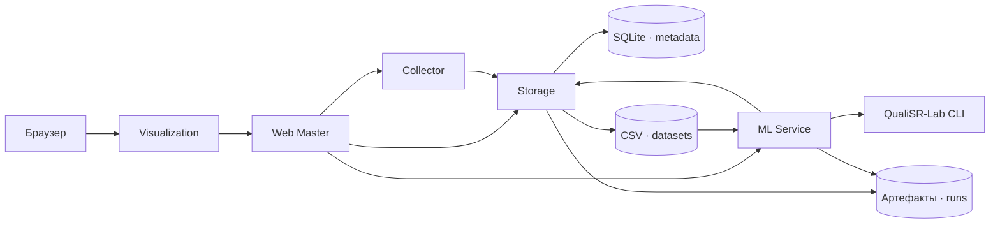

# QualiSR Microservices

Итоговый отчёт по проектному заданию «Построение системы микросервисов для поддержки дипломной работы». [Условия задания](../task.pdf)

## Задача

Исследователь сравнивает качество изображений после сверхразрешения по субъективным оценкам MOS (Mean Opinion Score). Сервис позволяет проверить, насколько регрессоры на предвычисленных признаках согласуются с MOS, и сопоставить их с отдельными IQA-метриками. Для повторения эксперимента сохраняются исходный конфиг CLI, идентификатор и контрольные суммы датасета, параметры разбиения и результаты.

Встроенный QualiSR-Set120 содержит 120 оценок MOS для 40 исходных изображений и трёх методов сверхразрешения (PASD, RealESRGAN, SUPIR). В проекте доступны готовые таблицы NR и FR, статистики, признаки энкодеров и готовые PCA-компоненты. Для запуска достаточно CSV. [Исходные данные](../data/) · [Описание признаков](../data/features/readme.md)

## Сценарии использования

| Сценарий | Действие исследователя | Результат |
| --- | --- | --- |
| Подготовка данных | Выбрать QualiSR-Set120 или импортировать `labels.csv` и CSV признаков | Схема и размеры датасета, журнал импорта и выдача строк батчами через API |
| Проверка регрессора | Выбрать признаки, модели и seed, запустить групповой split 80/20 | PLCC/SRCC на тестовой выборке для регрессоров и доступных IQA-метрик |
| Кросс-валидация | Выбрать групповой CV и число фолдов | PLCC/SRCC по фолдам, сводка со стандартным отклонением, OOF-предсказания |
| Разбор и сравнение | Открыть историю и отметить завершённые эксперименты | Проверка совпадения выборок, интерактивный график MOS и предсказаний, важность признаков, скачиваемые JSON/CSV и журнал |

## Архитектура



| Сервис | Ответственность |
| --- | --- |
| Collector | Регистрирует встроенный набор, проверяет multipart-импорт, читает CSV батчами. Записи об импорте хранит через Storage. |
| Storage | Предоставляет CRUD для датасетов и экспериментов, регистрирует артефакты с SHA-256. Проверяет зависимости при удалении. SQLite хранит метаданные, файлы находятся в отдельных томах. |
| ML Service | Проверяет настройки, исполняет FIFO-очередь с одним активным запуском, формирует отдельный JSON и вызывает `qualisr-run-regressors --config …`. Успех зависит от кода выхода и проверки предсказаний и корреляций. |
| Web Master | Публичный REST API для импорта, запуска, чтения статуса, истории и скачивания артефактов. |
| Visualization | Веб-формы, таблицы и график Plotly. Запрашивает данные только через Web Master. |

Каждый сервис содержит FastAPI-приложение, собственный Dockerfile и `GET /health`. Compose публикует на loopback только Web Master и Visualization. ML получает том `datasets` в режиме чтения и записывает результаты в `runs/<run_id>/`. Тома `metadata`, `datasets` и `runs` сохраняют историю между пересозданиями контейнеров. Проект использует CLI QualiSR-Lab как зависимость только ML Service, чтобы расчёты регрессоров и метрик шли по одному научному протоколу. [Compose](../docker-compose.yml) · [Параметры сервисов](../configs/services.json)

## Данные и конфигурация

- `labels.csv` в UTF-8 содержит `method`, `test_case` и конечное числовое значение `score`. Пара `method` и `test_case` определяет один образец. Колонка `image` может присутствовать, standalone CLI её игнорирует.
- Каждый файл признаков называется `<группа>.csv`, например `nr.csv`. Имя группы состоит из строчных латинских букв, цифр и подчёркиваний, начинается с буквы и содержит до 64 символов. Нужны `sample_id` и хотя бы один числовой признак. `score` остаётся в labels. Для известных SR-методов префикс ключа использует каноническое имя, например `QualiSR-Set120/PASD/1024x768___4962875195.npy.gz`.
- Каждая таблица признаков содержит тот же набор уникальных `sample_id`, что и labels. Пропуски можно записать пустыми значениями, `NaN` или `nan`. Шаблон использует медиану по обучающей части и требует хотя бы одно конечное обучающее значение на признак. Для каждого выбранного FR-референса нужна колонка с его суффиксом, например `_rlfn`. Имена колонок в объединяемых группах признаков должны различаться. Суммарный лимит файлов одного импорта равен 64 МиБ.
- Шаблон регрессоров задаёт препроцессинг, метрики и графики. Для запуска ML подставляет `seed`, `split_seed`, настройки моделей, режим и пути. Полный входной JSON с контрольными суммами датасета и версиями вычислительной среды сохраняется в `runs/<run_id>/config.json`, stdout и stderr в `runner.log`. [Шаблон регрессоров](../configs/templates/regressors.json) · [Формат JSON и дерево результатов](qualisr-cli.md)

## Публичный API

Интерактивная спецификация Web Master доступна на `/docs`, JSON-схема на `/openapi.json`. Адрес по умолчанию `http://127.0.0.1:8080`.

| Метод и путь | Назначение |
| --- | --- |
| `GET /health` | Готовность Web Master. Состояния остальных контейнеров видны в Compose. |
| `GET /datasets`, `GET /datasets/{id}` | Список и метаданные датасетов |
| `POST /datasets/import` | Multipart с `name`, файлом `labels` и одним или несколькими полями `features`. Возвращает датасет и `import_id`. |
| `GET /imports`, `GET /imports/{id}` | Список и детали импортов, включая ошибки валидации |
| `GET /datasets/{id}/batches` | Чтение labels или группы `feature`. `offset` по умолчанию 0, `limit` по умолчанию 50 и принимает от 1 до 500. |
| `PATCH /datasets/{id}`, `DELETE /datasets/{id}` | Переименование и удаление. Встроенный набор и датасеты с экспериментами защищены от удаления. |
| `POST /experiments` | Валидация JSON и создание эксперимента со статусом `created` |
| `POST /experiments/{id}/run` | Постановка в очередь. Возвращает HTTP 202 и статус `queued`. |
| `GET /experiments`, `GET /experiments/{id}` | История, параметры, текущее состояние, время начала и окончания, код выхода и ошибка |
| `GET /experiments/{id}/results` | Корреляции завершившегося успешно запуска. Для CV возвращает также оценки по фолдам. |
| `GET /experiments/{id}/log` | Журнал процесса после появления файла |
| `GET /experiments/{id}/artifacts`, `GET /artifacts/{id}` | Реестр артефактов и скачивание отдельного файла |
| `DELETE /experiments/{id}` | Удаление записи и её файлов. Активные и ожидающие запуски защищены. |

Статусы запуска идут по цепочке `created → queued → running → succeeded/failed`. Некорректный ввод возвращает 422, неизвестный ресурс 404, конфликт состояния или зависимостей 409. Ошибка CSV включает `import_id`, если Collector начал обработку. При отказе CLI результаты недоступны, журнал и исходный JSON можно забрать из артефактов после завершения.

## Воспроизводимый запуск и защита

```bash
docker compose up --build -d --wait
docker compose ps
python3.12 -m venv .venv
.venv/bin/python -m pip install -r requirements.txt
.venv/bin/python scripts/demo.py
```

Скрипт выполняет split и 4-fold CV на встроенном наборе с признаками NR/FR, референсом RLFN, `seed=42`, `split_seed=42` и Random Forest на 16 деревьях. Он выводит идентификаторы запусков, корреляции и ссылки на конфиги, реестр артефактов и журналы. Для одного режима доступен `--mode split` или `--mode cv`. При нестандартном порте задайте `QUALISR_API_URL`. [Команды для Podman и примеры REST](../README.md)

Для показа в браузере откройте `http://127.0.0.1:8501` и последовательно выполните четыре сценария из таблицы.

1. Импортируйте `data/labels.csv`, `data/features/nr.csv` и `data/features/fr.csv` под новым именем. Раскройте список колонок и файлов и покажите 120 строк и 40 групп.
2. Выберите встроенный набор, оставьте NR, FR, RLFN и Random Forest по умолчанию. Запустите split. Покажите таблицу PLCC/SRCC, 24 точки на графике, журнал и исходный JSON.
3. На встроенном наборе переключитесь на CV с четырьмя фолдами. Покажите таблицу по фолдам, 120 OOF-точек и графики важности отдельных фолдов.
4. Отметьте split и CV в истории. Покажите, что разные протоколы образуют разные группы сравнения. При выборе двух split с одинаковым датасетом и разбиением интерфейс подтвердит совпадение оценочных `sample_id`.

### Полученные результаты

Измерения ниже относятся к запуску демонстрационного скрипта на QualiSR-Set120. В split использовано 24 строки из восьми тестовых групп. В CV показано среднее по четырём фолдам, по 30 validation-строк в каждом. OOF покрывает все 120 строк. В обоих режимах число оценённых примеров у IQA-метрик совпало с покрытием регрессора.

| Модель / метрика | Split PLCC | Split SRCC | CV PLCC | CV SRCC |
| --- | ---: | ---: | ---: | ---: |
| Random Forest | 0.7435 | 0.7452 | 0.6077 | 0.6192 |
| MUSIQ (NR) | 0.7386 | 0.7478 | 0.5260 | 0.5252 |
| LPIPS-VGG+GT (FR) | 0.3060 | 0.2478 | 0.1913 | 0.1424 |

Группировка по `test_case` держит все SR-версии одного исходника в одной части каждого разбиения. Smoke-тест CLI независимо сверяет `sample_id` и пересчитывает корреляции на тех же строках. При неполных IQA-данных приложение показывает `n_samples` и отмечает несопоставимость. PLCC/SRCC в сводке CV усреднены по фолдам. Объединённые OOF-значения используются для визуализации предсказаний. Результаты демонстрируют работу системы на одном наборе и заданных настройках.

### Проверки стабильности

| Проверка | Наблюдение |
| --- | --- |
| Вход и валидация | Пустые и повреждённые CSV, отсутствующие и дублированные ID, нечисловые признаки, несовместимые группы и референсы, неверные гиперпараметры и параметры split/CV получили ожидаемые 422. Число `1e400` в гиперпараметре также вернуло 422 с путём к полю в обоих внешних API. Неизвестный датасет вернул 404. |
| Отказ CLI | Признак без конечных обучающих значений привёл к ненулевому коду. Постоянные предсказания дали код 0 и неопределённые корреляции. Оба запуска записаны как `failed` с журналами. |
| Очередь и изоляция | При одновременной отправке двух разных запусков и дубликата запроса на старт приняты оба уникальных запуска, дубликат получил 409. Запуски выполнились последовательно в порядке очереди, конфиги и предсказания хранились по разным путям. |
| Сохранность | После пересоздания пяти контейнеров сохранились импортированный датасет и его батч, записи об импорте, два успешных и два неуспешных запуска. SHA-256 всех 81 скачанного артефакта совпали с реестром до и после пересоздания. |
| Smoke | CLI проверен для split и CV. Сквозной тест проверил split и CV с Random Forest, XGBoost и CatBoost, артефакты, импорт, батчи и CRUD. |

Среда проверок 6 ноября 2026 года. Podman 5.8.9, Docker Compose 2.40.3, Python 3.12.15 в ML-контейнере, QualiSR-Lab 0.2.0, NumPy 2.2.6, pandas 2.3.3, scikit-learn 1.7.2, XGBoost 3.2.0 и CatBoost 1.2.10. [Команды тестирования](../README.md#демонстрация-и-сквозная-проверка)

При повторной проверке под Docker Engine 29.9.2 и Compose 2.40.3 прошли оба smoke-теста, сценарий демонстрации и сверка SHA-256 для 81 артефакта после пересоздания контейнеров. При запуске с новыми томами Collector зарегистрировал встроенный набор с 19 группами признаков. После принудительного завершения ML прерванный запуск получил статус `failed`, его журнал сохранился, а следующий запуск из очереди выполнился. На импортированном наборе с `stats` и `resnet_pca5` удаление одного значения MUSIQ из тестовой выборки дало 23 оценённые строки для метрики при 24 предсказаниях регрессора. В Firefox проверены импорт CSV, запуск из истории, график split/CV, журнал, конфиг и сравнение протоколов.

## Ограничения

- Standalone-режим QualiSR-Lab 0.2.0 фиксирует `test_size=0.2`. Для CV число фолдов ограничено числом групп. Если в оценочной части корреляция не определена, эксперимент получает статус `failed`.
- Встроенные и импортированные PCA-колонки используются как готовые признаки. Групповое разбиение разделяет данные для обучения регрессора. Для оценки всего конвейера с PCA нужно отдельно подтвердить, что преобразование обучалось только на обучающей части соответствующего разбиения.
- Поддерживается один локальный ML-воркер. Очередь и её статусы хранит Storage. Если ML прерван во время обучения, он завершает текущую задачу со статусом `failed` или фиксирует этот статус при следующем старте. Завершённые записи сохраняются в томах Compose.
- Применение модели выполняется на тестовой выборке или validation-фолдах эксперимента. В объём проекта входят конфиги, предсказания, корреляции, графики и журналы. Сериализация обученных моделей, инференс на новых данных, извлечение признаков из изображений и аутентификация выходят за его рамки.
